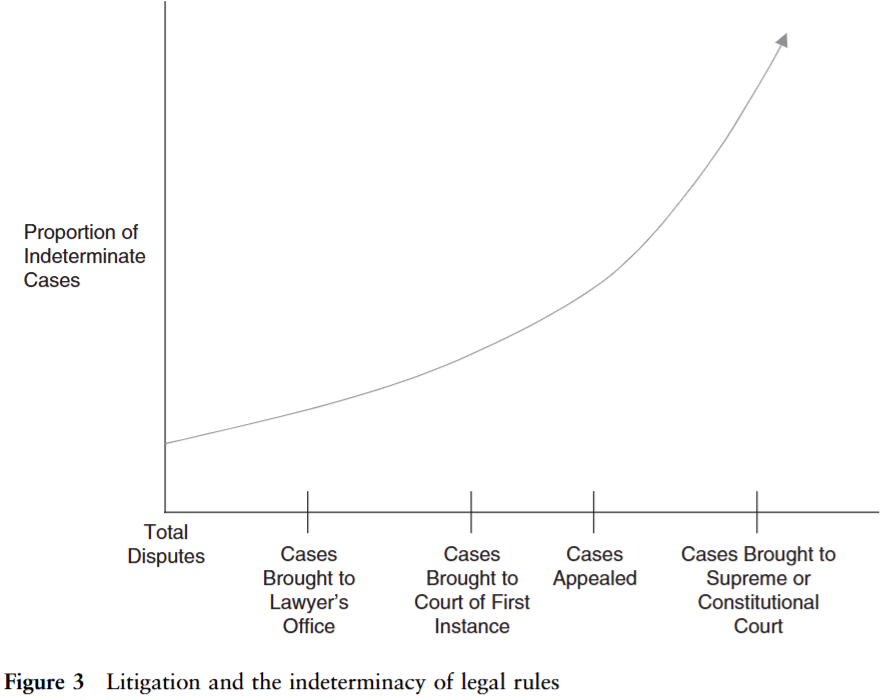

```{r globals, warning=FALSE, message=FALSE, error=FALSE}
source("utils/globals.R")
```

## How do judges make decisions?

-   modern judges are meant to apply legal rules to establish facts and decide disputes about the law
-   in the process of doing so, they are frequently the ultimate authority deciding what the law "is" (and isn't)
-   in this module we will be more concerned with how judges make decisions rather than how they *should* make decisions

## This week

-   this week we look at

    -   why the law alone does not decide cases

    -   attitudinal explanations and how we measure judicial preferences

    -   economic and cognitive explanations

    -   where judicial preferences come from

## How do judges make decisions?

-   the **legalist** perspective

    $$
        decision = facts \times law
    $$

    -   judges consistently apply legal rules to decide disputes

    -   decisions are only guided by facts and the law

    -   judges assess both facts and the law objectively

    -   the ruling is an honest representation of the judge's views

## Legalism {.smaller}

-   *assumptions* behind the **legalist** perspective

    -   there is one or "best" answer to any legal dispute

    -   legal rules are determinate and contain solutions to problems

    -   judges are capable of identifying the best legal answer to a problem

-   *issues* with the **legalist** perspective

    -   judges have preferences and unconscious biases

    -   there are often many overlapping rules

    -   there are often many possible ways to decide a dispute (discretion)

## Complexity of rules {.smaller}

Let's consider the following simplistic case.

**Law:**

Rule 1: The government can force foreign companies to sell their assets if they threaten national security.

[Rule 2: Companies are free to operate a business in the country.]{style="color:red;"}

[Rule 3: Individuals have a right to express themselves freely.]{style="color:red;"}

**Facts**:

A company based in a rival country wields a lot of influence in the Country. Its service facilitates the freedom of expression of millions of people. It collects data about its users. It does not share the data with the rival government. The Government invokes Rule 1 and orders a sale of the company's assets. The company disputes the legality of the order.

::: notes
Build the slide up in class: start with Rule 1 alone, then add Rule 2, then Rule 3, asking each time how the case should be decided.
:::

## Complexity of rules

-   in a real legal system, there are millions of rules

    -   which subset of them should be applied in a case?

-   the interpretation of both facts and the law entails discretion

## Ambiguity and disputes

```{r ambigsigmoid}
# sigmoidal function
scurve <- function(x){
  y <- exp(x) / (1 + exp(x))
  return(y)
}

# plot
ggplot(data = data.frame(x = c(-4, 4)), aes(x)) +
  geom_rect(xmin = 0, xmax = 4.1, ymin = 0.5, ymax = 1, color = "grey80", fill = "#e3c1d3") +
  stat_function(fun = scurve, n = 100, linewidth = 0.8) +
  theme_arrows() +
  labs(x = "Legal ambiguity", y = "Probability of court involvement",
       title = "Selection effects",
       subtitle = "More ambiguous issues are more likely to make it before courts")
```

## Ambiguity and disputes

-   where the law is perceived as unambiguous, it is less likely that a plaintiff would sue

    -   there will be exceptions, e.g. criminal trials (but settlements)

-   the more ambiguity, the more discretion a judge has in deciding

## Ambiguity and disputes

{width="400"}

## Judges in the lab {.smaller}

-   @spamann2021judges gave 299 judges from seven countries the same war crimes appeal

    -   randomly varying the precedent, how sympathetic the defendant was and a sentencing anchor

-   because the variation was random, any difference in decisions must come from what was varied

-   precedent barely made a difference, while the defendant and the anchor did

-   judges differed by country but not between common law and civil law

# Attitudinal explanations

## Attitudinal explanations

-   the law alone does not determine case outcomes; judges' attitudinal preferences matter more

-   originally motivated by the study of the US Supreme Court (SCOTUS)

-   judges have political preferences which can be ideological or even partisan

-   judges might seek desired policy outcomes consciously or subconsciously

## Attitudinal explanations

```{r scotusnews}
# data from Epstein et al
usjustices <- read_csv("data/justicesdata2022.csv")

# plot
usjustices |>
  filter(!str_detect(ideo, "^8")) |>
  distinct(name, .keep_all = T) |>
  mutate(ideo = as.numeric(ideo),
         name = str_extract(name, ".*?(?=,)")) |>
  filter(ideo < 1.01) |>
  ggplot(aes(y = ideo, x = yrnom)) +
  geom_text(aes(label = name), alpha = 0.8,
            position = position_jitter(width = 5, height = 0.03)) +
  geom_smooth(fill = "grey80") +
  scale_x_continuous(n.breaks = 10) +
  theme_minimal() +
  theme(
    axis.title.x = element_text(face = "bold"),
  ) +
  labs(x = "Year of nomination", y = "Conservative - Liberal",
       title = "Ideology scores for SCOTUS justices",
       subtitle = "Segal & Cover score of nominee's ideology based on newspaper editorials",
       caption = "Data source: The U.S. Supreme Court Justices Database")
```

## Attitudinal explanations {.smaller}

-   SCOTUS votes can be predicted from newspaper editorials about the nominees [@segal1989ideological; @cameron2009how]

-   partisan identification predicts how US judges decide

    -   elsewhere other attitudes matter, e.g. religiosity in Israel [@weinshallmargel2011attitudinal]

-   many judicial attitudes can be mapped onto a left-right dimension of political conflict

-   variation in attitudes stems from a number of sources, including judges' background characteristics

## Attitudinal explanations {.smaller}

> "judges’ decisions are a function of what they prefer to do, tempered by what they think they ought to do, but constrained by what they perceive is feasible to do" [@gibson1983simplicity, p. 9]

-   attitudinal explanations are most relevant in "policy" cases, i.e. when matters of public policy play a role in the dispute

-   judicial preferences and decision-making are multidimensional – the identity of the median justice might vary by issue area [@lauderdale2012supreme]

    -   the power of the unidimensional explanation tends to be lower outside the US context

# Learning about judicial preferences

## Learning about judicial preferences {.smaller}

-   one of the most challenging tasks in the study of judicial behaviour is **measuring** judicial preferences

-   judges operate much more secretively than politicians and are therefore more difficult to approach (for interviews, surveys, experiments)

    -   even if we could ask judges about their preferences, it is unlikely they would answer sincerely (**social desirability bias**)

-   the most common way of learning about judicial preferences is by looking at what judges decide

    -   **pros**: real behaviour (vs experimental hypotheticals); revealed (vs stated) preferences

    -   **cons**: "post-treatment"; motivated reasoning; requires individual positions (on panels); comparability requires random case assignment

## The case space model


-   imagine a one-dimensional space mapping countries by how dangerous they are to live in

## The case space model


-   imagine each case concerns an asylum application from a different country of origin

## The case space model


-   the judge prefers to **grant** all applications to the left of their ideal point and to **deny** all applications to the right of it

## The case space model


-   which judge is the most conservative?

-   which judge is the median judge?

::: notes
The intermediate builds (case-space-3 to case-space-8) are in img/ if the step-by-step version is preferred.
:::

## From votes to ideal points {.smaller}

-   aggregating judicial preferences from decisions is not as straightforward as taking the average of yes/no votes

    -   a vote in favour of the plaintiff might be associated with both ends of the policy spectrum

-   ideal point models use many votes at once to estimate each judge's position and where each case splits the judges [@martin2002dynamic]

-   the recovered dimension could in principle be anything

    -   researchers need to validate it against additional information about cases and judges (e.g. left-right)

## Do ideal points capture ideology?

```{r mquinn}
# data
scotus_mq <- read_csv("data/justices_mquinn.csv")

# plot
mq_sc <- scotus_mq |>
  mutate(justice = as.character(justice)) |>
  summarise(mean = mean(post_mn, na.rm = T), .by = c(justiceName, justice)) |>
  left_join(usjustices, by = c("justice"="spaethid")) |>
  mutate(ideo = as.numeric(ideo)) |>
  filter(ideo < 1.01)

mq_sc_cor <- cor(mq_sc$mean, 1 - mq_sc$ideo, use = "complete.obs")

mq_sc |>
  ggplot(aes(y = mean, x = 1-ideo)) +
  geom_point() +
  geom_smooth(method = "lm") +
  theme_minimal() +
  labs(y = "Martin-Quinn Score", x = "Segal-Cover Score (reversed)",
       title = "Ideology and voting on SCOTUS",
       subtitle = paste0("The correlation between estimated ideology and voting is ", round(mq_sc_cor, 2)))
```

# Economic explanations

## Economic explanations

-   judges are **self-interested** agents who want to maximize their utility

-   on the one hand, judges care about reputation, salary, career progress and personal satisfaction

-   on the other hand, judges care about having free time

## Economic explanations

```{r utility1}

# Define utility functions
utility_linear <- function(U, quality) U - quality
utility_cobb_douglas <- function(U, quality) U / sqrt(quality)
utility_perfect_complements <- function(U, quality) pmax(0, U - quality)

# Generate data for utility functions
generate_utility_data <- function(U_levels, quality_vals, utility_func, name) {
  data_list <- lapply(U_levels, function(U) {
    leisure_vals <- utility_func(U, quality_vals)
    data.frame(
      QualityOfWork = quality_vals[leisure_vals >= 0 & !is.infinite(leisure_vals)],
      Leisure = leisure_vals[leisure_vals >= 0 & !is.infinite(leisure_vals)],
      Utility = sprintf("%s (U = %d)", name, U)
    )
  })
  do.call(rbind, data_list)
}

# Parameters
quality_vals <- seq(0, 10, by = 0.1)
U_levels <- c(5, 10, 15)

# Create data for each utility function
data_linear <- generate_utility_data(U_levels, quality_vals, utility_linear, "Linear")
data_cobb <- generate_utility_data(U_levels, quality_vals, utility_cobb_douglas, "Cobb-Douglas")
data_complements <- generate_utility_data(U_levels, quality_vals, utility_perfect_complements, "Perfect Complements")

# Combine all data
data <- rbind(data_cobb, data_linear)

# Plot the utility functions
data |>
  filter(str_detect(Utility, "Cobb")) |>
  ggplot(aes(x = QualityOfWork, y = Leisure, color = Utility)) +
  geom_line(size = 1, show.legend = FALSE) +
  labs(
    title = "Utility functions with diminishing returns",
    subtitle = "Judges with different levels of productivity",
    x = "Quality of Work",
    y = "Leisure Time",
    color = "Utility Function"
  ) +
  scale_color_brewer(palette = "Set2") +
  theme_arrows()
```

::: notes
Judges are willing to substitute quality for leisure time and vice versa. Each curve offers a fixed amount of utility – sliding along the curve is just changing the trade-off. Curve further from the origin means more total utility (= higher productivity). Some judges are more productive than others (as shown in the graph). In reality, some judges value leisure, relative to quality, more than others as well (but this is not very much captured here).
:::

## Economic explanations {.smaller}

-   judges prefer writing better researched rulings over producing more of them [@ash2015intrinsic; @engel2020manna]

-   judges have strong intrinsic motivation to perform well [@ash2015intrinsic; @engel2017you]

    -   facing elections lowers rather than raises their performance [@ash2015intrinsic]

-   making leisure time more attractive (e.g. basketball tournament) makes judges do less and worse work [@clark2018estimating]

-   career incentives reward judges who are rarely overturned [@salzberger1999judicial] and who defer to the government [@sisk1998charting; @ramseyer2001why]

# Cognitive explanations

## Cognitive explanations

-   less fully formed theories of decision-making and more studies of various types of cognitive 'biases'

-   people are only boundedly rational and instead of conducting strictly rational calculations rely on (biased) heuristics

-   there are a number of common cognitive heuristics, e.g. anchoring, framing, hindsight bias, which have been shown to affect judges [@guthrie2001inside; @guthrie2002judging]

## Cognitive explanations {.smaller}

**Anchoring**: an initial value influences one's perception of a reasonable estimate of a value.

-   @guthrie2001inside ask judges to award damages in a personal injury case – those exposed to an irrelevant low number awarded 29% less in damages on average

-   judges fined a nightclub more when its name (after its street address) was Club 11,866 rather than Club 58 [@rachlinski2017judging]

-   young German lawyers gave longer sentences when loaded dice set a higher prosecution demand [@englich2006playing]

## Cognitive explanations {.smaller}

**Framing**: categorization of decision options as more or less positive. Most people are risk-averse when looking at potential gains and risk-seeking when choosing between options representing losses.

-   when framing a (sure) settlement as a gain, judges were more likely to endorse it than when framed as a loss [@guthrie2001inside]

-   choosing between reorganization plans, bankruptcy judges favoured the certain plan more when it was framed as a gain [@rachlinski2006inside]

## Cognitive explanations {.smaller}

-   in experiments with the public, ideological bias is driven by in-group favoritism [@kantorowiczreznichenko2022ideological]

    -   Arab defendants in Israel get lighter sentences on appeal when an Arab judge sits on the panel [@grossman2016descriptive]

    -   judges punish out-of-state defendants more [@wistrich2015heart]

    -   but in-group bias findings are likely exaggerated by publication bias [@ash2025ingroup]

## Cognitive explanations {.smaller}

-   US Supreme Court justices give away their preferences through emotional arousal in oral arguments [@dietrich2019emotional]

-   legal training did not reduce motivated reasoning when law students judged how similar precedents were [@braman2007mechanism]

-   judges struggle to ignore inadmissible information [@wistrich2005can]

    -   and their written reasons rarely mention the extralegal factors that swayed them [@spamann2016justice; @liu2019legal]

## Cognitive explanations {.smaller}

-   events unrelated to the case can also affect decisions

    -   Louisiana juvenile court judges gave longer sentences in the week after an unexpected LSU football loss [@eren2018emotional]

    -   defendants receive shorter sentences on their birthday [@chen2023clash]

    -   parole boards granted fewer requests as each session went on, recovering after a food break [@danziger2011extraneous]

-   some of these findings have been challenged

    -   critics argue case order was not random, as prisoners without lawyers usually went last in each session [@weinshallmargel2011overlooked]

    -   fewer asylum grants on hot days [@heyes2019temperature] largely disappear once coding errors are fixed [@spamann2022comment]

# Identity and socialization

## Variation in judicial preferences

-   some judges are more ...

    -   ideological, partisan, competent, power-hungry, lazy, independent, ambitious, etc.

... than others

-   the sources of judicial preferences are manifold: background characteristics, experience, legal and political context

![Ideology of Democratic and Republican State Supreme Court Justices [@gibson2022judging]](img/dem-con-state-scs-ideo.png){width="55%"}

## Realizing judicial preferences {.smaller}

-   judicial preferences manifest most importantly in decisions

-   judges' ability to realize their preferences is constrained to varying degrees

    -   by the facts of the case, the law, the preferences of other deciding judges (panel decisions) and of other actors (e.g. the legislature)

    -   judges who anticipate these constraints are acting **strategically**, which we look at next week

-   a common objection to non-legal analyses of judicial behaviour is that disagreement between judges (or courts) is misrepresented as ideological

    -   if this objection holds, disagreements about the law should not correlate with disagreements about policy

    -   but e.g. almost all proponents of originalist interpretation of the US constitution also prefer conservative policies

## Empirical evidence

-   US appeals panels with a majority of Republican appointees apply different standards in capital cases, raising execution rates [@beim2021republicanmajority]

-   a law and economics training programme for US judges made them decide more conservatively [@ash2026ideas]

-   local Fox News viewership causes elected judges to impose harsher sentences [@ash2024conservative]

## Empirical evidence

-   West German courts with more Nazi-tainted judges convicted fewer accused Nazi criminals [@kern2024transitional]

-   high salience of immigration leads judges to decide asylum appeals less favourably [@spirig2023when]

-   US appeals judges with a daughter vote in a more feminist way on gender issues than those with only sons [@glynn2015identifying]

## References
