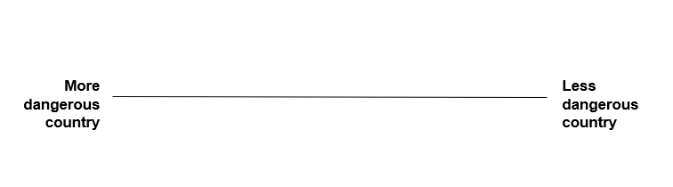
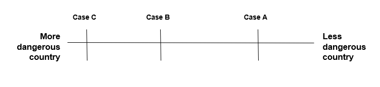
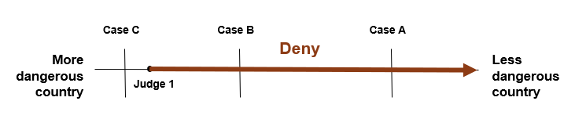
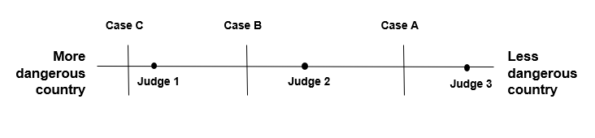

```{r globals, warning=FALSE, message=FALSE, error=FALSE}
source("utils/globals.R")
```

## How do judges make decisions?

-   modern judges are meant to apply legal rules to establish facts and decide disputes about the law
-   in the process of doing so, they are frequently the ultimate authority deciding what the law "is" (and isn't)
-   in this module we will be more concerned with how judges make decisions rather than how they *should* make decisions

## This week

-   this week we look at

    -   why the law alone does not decide cases

    -   attitudinal explanations and judicial preferences

    -   economic and cognitive explanations

# Legalism

## Legalism

-   the **legalist** perspective

    $$
        decision = facts \times law
    $$

    -   judges consistently apply legal rules to decide disputes

    -   decisions are only guided by facts and the law

    -   judges assess both facts and the law objectively

    -   the ruling is an honest representation of the judge's views

## Legalism {.smaller}

-   *assumptions* behind the **legalist** perspective

    -   there is one or "best" answer to any legal dispute

    -   legal rules are determinate and contain solutions to problems

    -   judges are capable of identifying the best legal answer to a problem

-   *issues* with the **legalist** perspective

    -   judges have preferences and unconscious biases

    -   there are often many overlapping rules

    -   there are often many possible ways to decide a dispute (discretion)

## Complexity of rules {.smaller}

Let's consider the following simplistic case.

**Law:**

Rule 1: The government can force foreign companies to sell their assets if they threaten national security.

[Rule 2: Companies are free to operate a business in the country.]{style="color:red;"}

[Rule 3: Individuals have a right to express themselves freely.]{style="color:red;"}

**Facts**:

A company based in a rival country wields a lot of influence in the Country. Its service facilitates the freedom of expression of millions of people. It collects data about its users. It does not share the data with the rival government. The Government invokes Rule 1 and orders a sale of the company's assets. The company disputes the legality of the order.

::: notes
add the rules one at a time and ask each time how the case should be decided
:::

## Complexity of rules

-   in a real legal system, there are millions of rules

    -   which subset of them should be applied in a case?

-   the interpretation of both facts and the law entails discretion

## Ambiguity and disputes

```{r ambigsigmoid}
# sigmoidal function
scurve <- function(x){
  y <- exp(x) / (1 + exp(x))
  return(y)
}

# plot
ggplot(data = data.frame(x = c(-4, 4)), aes(x)) +
  geom_rect(xmin = 0, xmax = 4.1, ymin = 0.5, ymax = 1, color = "grey80", fill = "#e3c1d3") +
  stat_function(fun = scurve, n = 100, linewidth = 0.8) +
  theme_arrows() +
  labs(x = "Legal ambiguity", y = "Probability of court involvement",
       title = "Selection effects",
       subtitle = "More ambiguous issues are more likely to make it before courts")
```

## Ambiguity and disputes

-   where the law is perceived as unambiguous, it is less likely that a plaintiff would sue

    -   there will be exceptions, e.g. criminal trials (but settlements)

-   the more ambiguity, the more discretion a judge has in deciding

## Ambiguity and disputes

![Source: @dyevre2010unifying [p. 313]](img/dyevre-indeterminacy.png){width="400"}

# Attitudinal explanations

## Attitudinal explanations

-   the law alone does not determine case outcomes; judges' attitudinal preferences matter more

-   originally motivated by the study of the US Supreme Court (SCOTUS)

-   judges have political preferences which can be ideological or even partisan

-   judges might seek desired policy outcomes consciously or subconsciously

## The case space model



-   imagine a one-dimensional space mapping countries by how dangerous they are to live in

## The case space model



-   imagine each case concerns an asylum application from a different country of origin

## The case space model



-   the judge prefers to **grant** all applications to the left of their ideal point and to **deny** all applications to the right of it

## The case space model



-   which judge is the most conservative?

-   which judge is the median judge?

## Attitudinal explanations {.smaller}

-   SCOTUS votes can be predicted from newspaper editorials about the nominees [@segal1989ideological; @cameron2009how]

-   partisan identification predicts how US judges decide

    -   elsewhere other attitudes matter, e.g. religiosity in Israel [@weinshallmargel2011attitudinal]

-   many judicial attitudes can be mapped onto a left-right dimension of political conflict

-   decisions may also reflect who the judge and the defendant are

    -   judges' gender, race or ethnicity sometimes predict how they decide [@harris2019bias]

    -   attitudes towards groups such as immigrants may shape how defendants are treated [@riaz2025antiimmigrant]

## Attitudinal explanations {.smaller}

> "judges’ decisions are a function of what they prefer to do, tempered by what they think they ought to do, but constrained by what they perceive is feasible to do" [@gibson1983simplicity, p. 9]

-   attitudinal explanations are most relevant in "policy" cases, i.e. when matters of public policy play a role in the dispute

-   judicial preferences and decision-making are multidimensional – the identity of the median justice might vary by issue area [@lauderdale2012supreme]

    -   the power of the unidimensional explanation tends to be lower outside the US context

## Attitudinal explanations

-   a common objection to non-legal analyses of judicial behaviour is that disagreement between judges (or courts) is misrepresented as ideological

    -   if this objection holds, disagreements about the law should not correlate with disagreements about policy

    -   but e.g. almost all proponents of originalist interpretation of the US constitution also prefer conservative policies

# Learning about judicial preferences

## Learning about judicial preferences {.smaller}

-   one of the most challenging tasks in the study of judicial behaviour is **measuring** judicial preferences

-   judges operate much more secretively than politicians and are therefore more difficult to approach (for interviews, surveys, experiments)

    -   even if we could ask judges about their preferences, it is unlikely they would answer sincerely (**social desirability bias**)

-   the most common way of learning about judicial preferences is by looking at what judges decide

    -   **pros**: real behaviour (vs experimental hypotheticals); revealed (vs stated) preferences

    -   **cons**: "post-treatment"; motivated reasoning; requires individual positions (on panels); comparability requires random case assignment

-   researchers also use the pitch of justices' voices in oral argument [@dietrich2019emotional]

## Random assignment {.smaller}

-   judges rarely decide the same cases, so differences in their decisions may reflect differences in their cases

-   when cases are assigned at **random**, each judge gets a similar mix of cases on average

    -   e.g. if asylum appeals are allocated by lottery, a judge who grants fewer of them is likely to be stricter

-   **experiments** follow the same logic by randomly varying one feature of a case and keeping the rest the same

-   the logic breaks down if judges or parties can influence who hears a case

# Economic explanations

## Economic explanations

-   judges are **self-interested** agents who want to maximize their utility

-   on the one hand, judges care about reputation, salary, career progress and personal satisfaction

-   on the other hand, judges care about having free time

## Economic explanations {.smaller}

-   making leisure time more attractive (e.g. basketball tournament) makes judges do less and worse work [@clark2018estimating]

-   judges prefer writing better researched rulings over producing more of them [@ash2015intrinsic; @engel2020manna]

-   judges have strong intrinsic motivation to perform well [@ash2015intrinsic; @engel2017you]

    -   judges perform worse when they face elections [@ash2015intrinsic]

-   career incentives reward judges who are rarely overturned [@salzberger1999judicial] and who defer to the government [@sisk1998charting; @ramseyer2001why]

# Cognitive explanations

## Cognitive explanations

-   less fully formed theories of decision-making and more studies of various types of cognitive 'biases'

-   people are only boundedly rational and instead of conducting strictly rational calculations rely on (biased) heuristics

-   there are a number of common cognitive heuristics, e.g. anchoring, framing, hindsight bias, which have been shown to affect judges [@guthrie2001inside; @guthrie2002judging]

## Cognitive explanations {.smaller}

**Anchoring**: an initial value influences one's perception of a reasonable estimate of a value.

-   @guthrie2001inside ask judges to award damages in a personal injury case – those exposed to an irrelevant low number awarded 29% less in damages on average

-   judges fined a nightclub more when its name (after its street address) was Club 11,866 rather than Club 58 [@rachlinski2017judging]

-   young German lawyers gave longer sentences when loaded dice set a higher prosecution demand [@englich2006playing]

## Cognitive explanations {.smaller}

**Framing**: categorization of decision options as more or less positive. Most people are risk-averse when looking at potential gains and risk-seeking when choosing between options representing losses.

-   when framing a (sure) settlement as a gain, judges were more likely to endorse it than when framed as a loss [@guthrie2001inside]

-   bankruptcy judges were more likely to choose a reorganization plan with a certain outcome when it was framed as a gain [@rachlinski2006inside]

## Cognitive explanations {.smaller}

-   legal training did not reduce motivated reasoning when law students judged how similar precedents were [@braman2007mechanism]

-   judges struggle to ignore inadmissible information [@wistrich2005can]

    -   and their written reasons rarely mention the extralegal factors that influenced them [@spamann2016justice; @liu2019legal]

## Cognitive explanations {.smaller}

-   events unrelated to the case can also affect decisions

    -   Louisiana juvenile court judges gave longer sentences in the week after an unexpected LSU football loss [@eren2018emotional]

    -   defendants receive shorter sentences on their birthday [@chen2023clash]

    -   parole boards granted fewer requests as each session went on and more again after a food break [@danziger2011extraneous]

-   some of these findings have been challenged

    -   critics argue case order was not random, as prisoners without lawyers usually went last in each session [@weinshallmargel2011overlooked]

    -   US immigration judges appeared to grant less asylum on hot days [@heyes2019temperature], but the effect largely disappears once coding errors are fixed [@spamann2022comment]

## Realizing judicial preferences

-   judicial preferences manifest most importantly in decisions

-   judges' ability to realize their preferences is constrained to varying degrees

    -   by the facts of the case, the law, the preferences of other deciding judges (panel decisions) and of other actors (e.g. the legislature)

    -   judges who anticipate these constraints are acting **strategically**

## References
