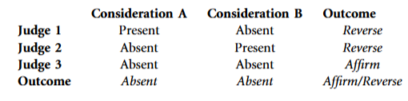
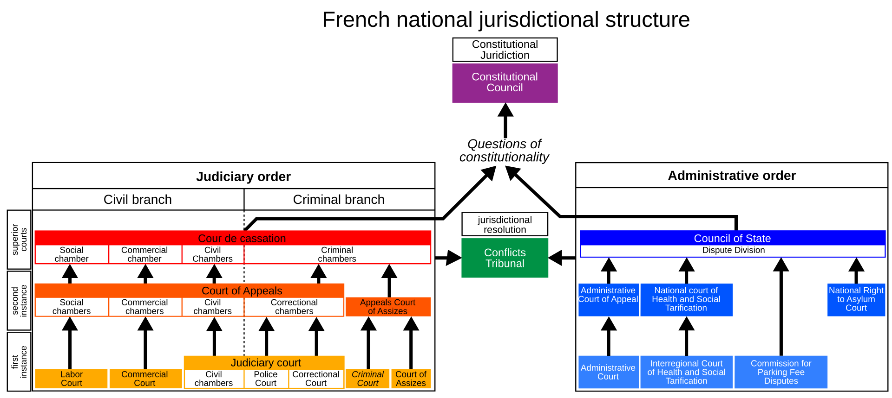

```{r globals, warning=FALSE, message=FALSE, error=FALSE}
source("utils/globals.R")
```

## This week

-   this week we look at

    -   some diverse sources of judicial preferences

    -   panels, the judicial hierarchy and juries

# Identity and socialization

## Variation in judicial preferences

-   some judges are more ...

    -   ideological, partisan, competent, power-hungry, lazy, independent, ambitious, etc.

... than others

-   the sources of judicial preferences are manifold: background characteristics, experience, legal and political context

## Variation in judicial preferences

![Ideology of Democratic and Republican State Supreme Court Justices [@gibson2022judging]](img/dem-con-state-scs-ideo.png)

:::.notes
ideology estimated from campaign-contribution datasets (Bonica)
:::

## In-group bias

-   in experiments with the Polish public, ideological bias is driven by in-group favouritism [@kantorowiczreznichenko2022ideological]

-   in an experiment, US state judges awarded higher punitive damages against an out-of-state defendant [@wistrich2015heart]

-   but across 5 million Indian criminal cases, judges show no in-group bias by gender or religion [@ash2025ingroup]

## Background and experience

-   US appeals judges with a daughter vote in a more feminist way on gender issues than those with only sons [@glynn2015identifying]

-   West German courts with more Nazi-tainted judges convicted fewer accused Nazi criminals [@kern2024transitional]

-   a law and economics training programme made US federal judges rule against regulators more often and sentence more harshly [@ash2026ideas]

## Political context

-   local Fox News viewership causes elected judges to impose harsher sentences [@ash2024conservative]

-   high asylum salience leads Swiss judges to decide asylum appeals less favourably [@spirig2023when]

## Deciding together

-   most consequential decisions are not made by a single judge acting alone

-   the decision often runs through other people

    -   **panels**: judges influencing one another

    -   the **hierarchy**: courts overseen by the courts above them

    -   **juries** and lay judges: citizens deciding next to or instead of professionals

# Panels

## Collegial courts

-   most important courts are collegial – they involve bargaining between multiple judges [@landa2009legal; @lax2007bargaining]

-   if opinion amendments by judges are costless, the result will align with the median judge's preferences

    -   if they are not, the opinion writer can pull the judgment slightly away from the median judge [@lax2007bargaining]

## Panel aggregation paradox {.smaller}

{width="500"}

-   voting on outcomes and voting issue by issue can give opposite results [@kornhauser1986unpacking; @landa2009legal]

-   either consideration is enough to reverse, so two of three judges vote to reverse

-   yet a majority finds each consideration absent, which means the decision is affirmed

## Chair or median? {.smaller}

-   often we do not observe the dynamics behind panel decisions

-   key question: how influential is the panel's opinion-writer/chair?

    -   reviewing / challenging the chair is costly for the other panel members

    -   @hangartner2025inferring show that in about half of Swiss Federal Administrative Court asylum cases, the panel defers to the chair (majority rule applies otherwise)

## Panel effects {.smaller}

-   on US appeals panels, judges vote more ideologically when both colleagues share their appointing party [@sunstein2004ideological]

-   and less ideologically when both colleagues were appointed by the other party

-   on the DC Circuit, majorities with one judge from the other party followed doctrine more often [@cross1998judicial]

    -   this **whistleblower** can expose the majority to higher courts by dissenting

-   panel composition is both a treatment (who influences whom) and a threat of exposure

## Panel composition {.smaller}

-   in some areas of law, judges respond to the gender and ethnicity of their co-panellists [@boyd2010untangling; @grossman2016descriptive]

-   on Germany's Federal Court of Justice, familiar judges hold more hearings and write longer judgments [@swalve2022does]

-   to increase efficiency, courts can create chambers consisting of sub-groups of judges [@fjelstul2023how]

    -   their composition can be more or less permanent and stable

    -   but small chambers are likely make the application of law less consistent [@fjelstul2023how]

## Case assignment

-   who decides who decides?

-   in some courts (e.g. CJEU), the president chooses the opinion writer (judge-rapporteur)

    -   a source of power the president uses strategically to build the court's legitimacy [@hermansen2020building]

    -   at SCOTUS, the most senior justice in the majority assigns the opinion [@lax2007bargaining]

-   random case assignment stops parties from steering cases to sympathetic judges [@marcondes2019assessing]

## Role of clerks

-   judges do not work alone – they are assisted by **law clerks**

    -   at SCOTUS, clerks' ideology shifts justices' votes, especially in close and high-profile cases [@bonica2019legal]

    -   US judges' gender and ideology shape whom they hire as clerks [@badas2025role]

-   judges, similar to politicians, have different styles

    -   e.g. some are more willing to trust and delegate work than others

# Hierarchy

## Organizing the judiciary

-   how are judiciaries organized?

-   what are the implications of organizational principles for judicial decision-making?

## Judicial hierarchy {.smaller}

-   virtually all judiciaries around the world are organized **hierarchically**

-   three "layers" are typical

    -   supreme and constitutional (peak) courts at the top

    -   courts of appeal in the middle

    -   first-instance (trial) courts at the bottom

-   peak courts = courts of final instance

    -   no more appeals possible

-   in many systems there are multiple hierarchies

    -   e.g. military courts or administrative courts (France)

## Judicial hierarchy



## Judicial motivation {.smaller}

-   judges at different levels of the pyramid face different pressures and incentives

    -   at the bottom, judges also weigh workload, reputation and promotion [@choi2012what]

    -   at the top, ideology has the strongest influence on judges' decisions [@zorn2010ideological]

-   @goto2026career presents evidence of judicial **pandering** in Indian courts

    -   high court chief justices influence which district judges are promoted to the high court

    -   eligible judges acquit female defendants more and male defendants less under a female chief justice

## Judicial discipline {.smaller}

-   discipline in the judicial hierarchy is maintained through two mechanisms:

    -   **precedents** or rules created by higher courts to be followed by lower courts

    -   oversight by higher courts or the threat of **reversing** lower court decisions

-   even jurisdictions which do not formally subscribe to *stare decisis* usually employ precedents

-   precedents transmit rules through time and the judicial hierarchy

-   courts higher in the hierarchy and later in time can amend or expunge lower or previous precedents

## Role of lower courts {.smaller}

-   in the standard account, lower courts implement the doctrines developed by peak courts [@songer1994hierarchy]

    -   they may try to make use of ambiguity to create room for their own preferences [@cameron2000strategic]

    -   upper courts correct their "errors"

-   in the '**reversed**' account, lower courts make their own doctrines [@carrubba2012rule]

    -   they have a first-mover advantage and are closer to case facts

    -   upper courts intervene when lower courts go too far

## The cost of review

-   upper courts do not have direct and immediate access to case facts, only to lower courts' decisions [@cameron2000strategic]

    -   they need to spend time and resources to find out more

    -   =\> upper courts need to decide which decisions are worth auditing

-   upper courts care about lower courts' **dispositions** *and* **rules** [@carrubba2012rule]

    -   lower courts choose rules to avoid review

## The cost of review

-   the ideal situation for the lower court is when the disposition aligns with the upper court's preferences

-   suppose the lower court prefers a liberal rule, while the upper court is more conservative. The facts are so extreme that almost any rule yields a "conservative" disposition (e.g. harsh sentence). The lower court can push the rule in a liberal direction until review becomes worth the upper court's cost [@carrubba2012rule]

## Fire alarms

-   appeal courts pick up on **signals** ("fire alarms" / whistleblowing) about whether a decision is worth reviewing [@beim2014whistleblowing]

    -   litigants filing appeals

    -   interest groups filing amicus curiae briefs

    -   lower court judges dissenting

::: notes
if the whistle is blown too often, it tells the upper court less, so the threat of review weakens and the lower court complies less
:::

## The threat of reversal {.smaller}

-   why do lower courts follow precedent? why do they fear reversal?

    -   reputation [@choi2012what]

    -   they value following the law, regardless of the risk of reversal [@cross2005appellate]

    -   they want to have influence over the law [@carrubba2012rule]

-   interpersonal contacts between lower and appeal judges dampen the effect of ideological distance [@nelson2022how]

    -   when two judges share a courthouse, ideology barely affects reversal

## The effect of reversal

-   trial judges in Norway who had their ruling overturned on appeal shift their behaviour in the corresponding direction [@bhuller2025feedback]

    -   "Following a decision reversal, trial judges who receive a sentence increase have almost 40 percentage points higher probability of incarcerating in the next case, compared to judges receiving a sentence affirmance"

    -   judges do not merely "learn" from reversals but **overreact** to them

## Hierarchy in the EU

-   in the European Union, national courts refer questions to the Court of Justice of the EU (CJEU). What happens when the CJEU dismisses them?

-   national courts receiving such a negative result are more likely to submit another case [@dyevre2022chilling]

    -   the CJEU is more likely to accept requests from national courts that previously experienced rejection

## Hierarchy in the EU

-   in some circumstances, judicial hierarchies are not universally accepted

    -   in the EU, the CJEU proclaims the doctrine of supremacy of EU law over national law and its own role as the ultimate arbiter of EU law questions

    -   from the CJEU's perspective, all national courts must follow its lead

    -   not all national courts accept that the CJEU sits atop the EU law hierarchy

## Hierarchy in the EU {.smaller}

> The Court of Justice of the European Union exceeds its judicial mandate, as determined by the functions conferred upon it in Article 19(1) second sentence of the Treaty on European Union, where an interpretation of the Treaties is not comprehensible and must thus be considered arbitrary from an objective perspective. **If the Court of Justice of the European Union crosses that limit**, its decisions are no longer covered by Article 19(1) second sentence of the Treaty on European Union in conjunction with the domestic Act of Approval; at least in relation to Germany, these decisions lack the minimum of democratic legitimation necessary under Article 23(1) second sentence in conjunction with Article 20(1) and (2) and Article 79(3) of the Basic Law.

German Constitutional Court, Judgment of the Second Senate of 5 May 2020 (2 BvR 859/15), headnote 2, emphasis added

# Juries

## Who decides besides judges?

-   there is a variety of jury and lay-judge systems around the world

    -  the English jury model is the most well-known with members of the public collectively deciding on the accused's guilt

    -  many countries (e.g. the UK) use laypersons to decide court cases, either alone or in collaboration with professional judges

## The Condorcet jury theorem

-   @condorcet1785essai: a majority is more likely right than any one member, if

    -   **competence**: each member is more likely right than wrong

    -   **independence**: each member decides for themselves

-   the larger the group, the more likely the majority is right (and vice versa)

    -   with jurors each right 60% of the time, a majority of 3 is right 65%, of 11 75%, of 51 93%

-   the standard argument for juries, panels and larger benches

## Real juries are not Condorcet juries

-   competence varies between jurors

-   votes are not independent -- jurors deliberate first

    -   persuasion and domination effects

    -   deliberation pushes groups further in the direction members already leaned (group polarization) [@schkade2000deliberating]

    -   the majority on the first ballot predicts the verdict in about nine juries in ten [@kalven1966american]

## Who is in the room matters {.smaller}

-   in two Florida counties, all-white jury pools convicted 81% of Black and 66% of white defendants [@anwar2012impact]

    -   at least one Black member in the pool closed the gap

-   in two Florida counties, own-gender jurors convicted less often on drug charges but not on others [@hoekstra2021effect]

-   randomly assigned Swedish lay judges from the far right convict young and Arabic-named defendants more often [@anwar2019politics]

-   in all three studies the pool or panel is as good as random, so the cases cannot explain the gaps

## Deliberation and history {.smaller}

-   jury deliberations are secret in most systems, which complicates doing research

    -   racially mixed mock juries deliberated longer, discussed more of the facts and made fewer factual errors than all-white juries [@sommers2006racial]

-   Old Bailey juries in 1751 to 1808 were more likely to convict right after a conviction [@bindler2019path]

-   across nearly 200 years of Old Bailey trials, women were convicted less often and punished less harshly than men [@bindler2020persistence]

## References
