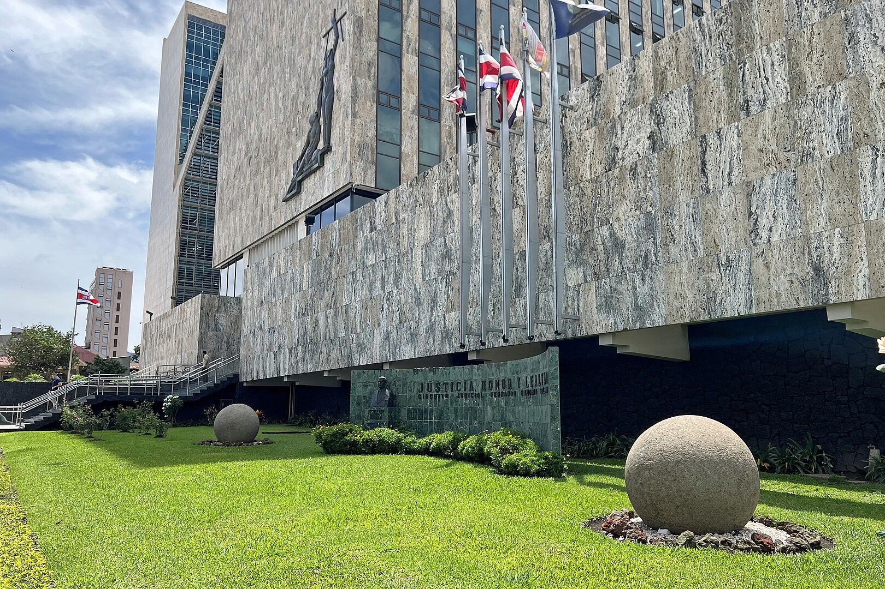
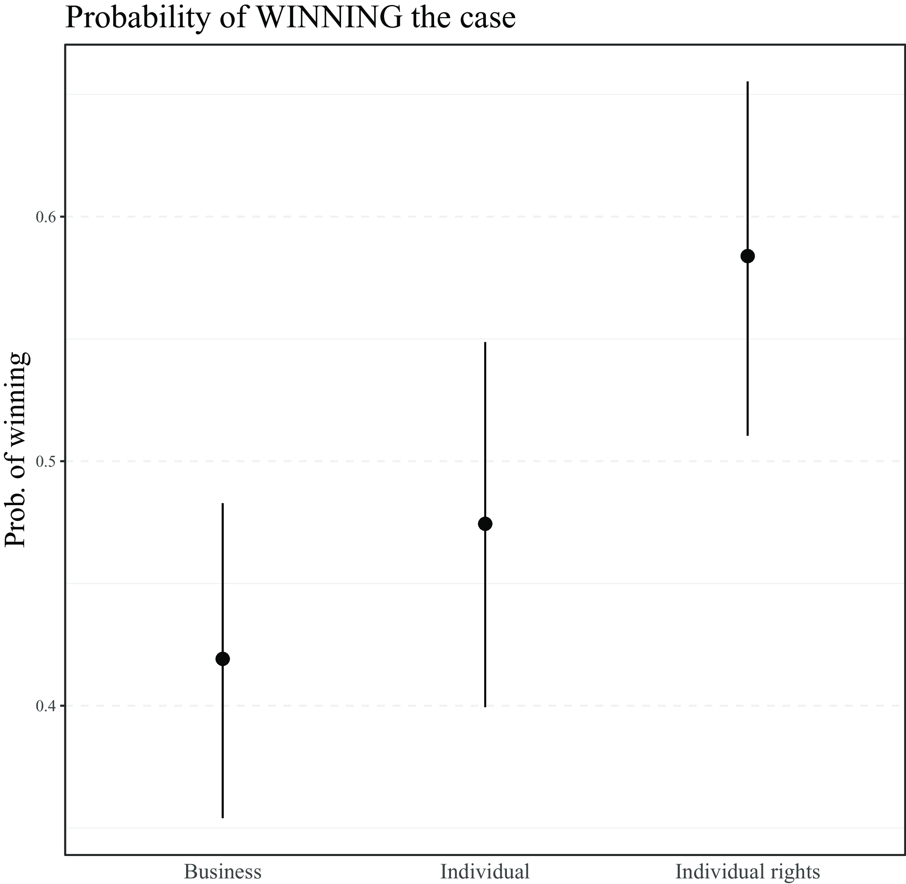

```{r globals, warning=FALSE, message=FALSE, error=FALSE}
source("utils/globals.R")
```

## Assessment {.smaller}

-   the deadline and submission instructions are on the module's **Moodle** page

-   what **theory** do you want to contribute to with your empirical analysis?

    -   derive a specific **hypothesis** from theoretical discussion

-   what **data** are you going to use to test your hypothesis?

-   what **method** are you going to use to analyse your data?

## Empirical paper {.smaller}

-   **Introduction**: what is the research puzzle/problem and why is it important?

-   **Literature review**: what we already know about the problem from previous research and what gap is going to be addressed by your paper

    -   examples of a gap: all evidence comes from a single jurisdiction; there is conflicting evidence; existing theories do not account for an important variable; etc.

-   **Theory**: a reasoned justification of (the logic behind) your principal expectation (**hypothesis**) prior to conducting the empirical analysis; must be informed by existing literature

    -   what puzzle does your theory attempt to explain?

    -   example of a hypothesis: "The likelihood of \[Supreme Court\] review should initially decrease and then increase in ideological distance \[from the lower court\]."

    -   what is your explanatory (independent) variable? What is your outcome (dependent) variable?

## Empirical paper {.smaller}

-   **Data:** information used to produce evidence and test your hypothesis

    -   which cases will offer leverage on your research problem?

    -   how do you operationalize your variables? What is the unit of analysis?

    -   what measurement choices were made in the construction of the dataset?

    -   you can use an existing dataset or collect your own data

    -   even in qualitative research keep meticulous track of your sources (transparency appendix)

-   **Methods/research design**: the empirical strategy used to test your hypothesis

    -   how do you analyse your data?

    -   what inferences does your method allow? e.g. average treatment effects vs mechanistic evidence

    -   what are the assumptions and limitations of the method?

## Empirical paper {.smaller}

-   **Findings and discussion**: the results produced by your empirical strategy and data

    -   what are the results of your analysis?

    -   what are the implications for your hypothesis? is there evidence in support of or against it?

    -   what are the implications for the broader theory and literature?

    -   what have we learned that we did not know before?

-   **Conclusion**: summarize findings, highlight main contribution and limitations, and offer thoughts on policy and future research avenues

## Legal mobilization

-   What kinds of individuals and groups resort to litigation?

-   What influences the likelihood of interest group litigation and what makes their success likely?

-   courts are passive and nothing happens until someone brings a case

## Legal mobilization

-   legal mobilization, or invoking legal norms, is "a form of political activity by which the citizenry uses public authority on its own behalf" [@zemans1983legal]

-   the enforcement of the law often depends on private (non-governmental) actors [@zemans1983legal]

    -   traditionally in the US ("adversarial legalism"), possibly also in the EU [@kelemen2012eurolegalism]

## Adversarial vs bureaucratic legalism

-   law and policy in the US are strongly shaped by means of "lawyer-dominated **litigation**" [@kagan2001adversarial]

-   economic liberalization and political fragmentation in the EU have been argued to be leading Europe down the American path [@kelemen2012eurolegalism]

-   in EU competition and securities law, public **agencies** rather than private litigants still do most enforcement [@foster2024legalism]

## Legal mobilization

-   "*the process by which individuals make claims about their legal rights and pursue lawsuits to defend or develop those rights*" [@epp1998rights, p. 18]

    -   "claims" not strictly invoking formal institutional mechanisms

    -   what exactly counts as legal mobilization is contested [@lehoucq2020conceptualizing]

## Why mobilize the law?

-   often targeting **legal change** through courts ("strategic litigation")

-   raise rights consciousness and improve **receptivity** to claims

-   generate media **attention** and public support

## Why not?

-   fear of creating **negative precedents** entrenching unfavourable outcomes

-   critics argue that judicial review of legislation lacks **democratic** legitimacy [@waldron2006core]

-   fear of **backlash** against the pursued cause [@klarman1994how]

    -   but other forms of policy change can also generate backlash [@keck2009beyond]

# Individuals

## From injury to lawsuit {.smaller}

-   most injuries never become disputes, let alone court cases [@felstiner1981emergence]

    -   an injury has to be perceived (**naming**), attributed to someone (**blaming**) and put to them (**claiming**)

-   each step is subjective and unstable, and lawyers, officials and friends can reshape it [@felstiner1981emergence]

```{r pyramid, fig.height=3.5}
#| fig-cap: "Source: @miller1981grievances"
tibble(stage = c("grievances", "claims", "disputes", "lawyer consulted", "court filings"),
       n = c(1000, 718, 449, 103, 50)) |>
  mutate(stage = factor(stage, levels = rev(stage))) |>
  ggplot(aes(x = n, y = stage)) +
  geom_col() +
  geom_text(aes(label = n), hjust = -0.2) +
  scale_x_continuous(expand = expansion(mult = c(0, 0.15))) +
  theme_minimal() +
  labs(x = NULL, y = NULL,
       title = "The dispute pyramid",
       subtitle = "Per 1,000 grievances worth $1,000 or more, households in five US judicial districts")
```

## Legal mobilization in Costa Rica

-   in 1989, the Costa Rican constitution was reformed to create a constitutional chamber in the Supreme Court

    -   @wilson2006legal argue that poorly organized marginalized groups won significant cases because access was cheap and easy

    -   an extensive list of constitutional rights also made these wins possible

::: notes
As an example, a 10-year-old boy whose school bus was always late filed a handwritten amparo without legal counsel. The court rejected it but the bus company responded positively, and over the next eight years he filed over 140 cases.
:::

## Legal mobilization in Costa Rica



## Individuals without organizations {.smaller}

-   Colombia's *acción de tutela* (1991): any person can file a complaint for the protection of a fundamental right, without a lawyer, and get a decision within ten days

    -   hundreds of thousands of tutelas are filed each year [@taylor2018ambivalent]

    -   Colombians report very low trust in the judiciary and file tutelas in enormous numbers anyway [@taylor2018ambivalent]

-   cheap tutelas suit individual claims, while costly South African courts favour NGO-backed collective claims [@taylor2020social; @taylor2023social]

-   cheap access can replace the support structure that @epp1998rights treats as crucial [@wilson2006legal]

# Organizations

## The drivers of legal mobilization

-   legal mobilization requires the capacity to navigate a complex organizational field

-   actors need to have the necessary resources (financial, expertise) to take advantage of the available *legal opportunity structure* (LOS)

    -   but LOS is not just exogenously given, acting on it shapes it going forward [@vanhala2012legal]

## Legal opportunity structure (static)

-   legal **stock**

    -   what rights and laws are available to "hang" your case on?

-   **access** to justice

    -   who can access the procedure and under what conditions?

-   legal **costs**

    -   how expensive is it to access the procedure and is legal aid available?

## Legal opportunity structure (dynamic)

-   the text of a law is only the starting point

    -   rules need to be interpreted in the process of being applied

-   actors attempt to mould LOS to their advantage by advancing new interpretations

    -   mostly before judges, but also e.g. MPs, ombudsmen

    -   some might not see an opportunity where there is one [@vanderpas2024all]

## Empirical examples

-   civil rights movements

    -   *Brown v Board of Education of Topeka* (1954)

    -   open LOS in US v closed LOS in NI [@defazio2012legal]

## Empirical examples

-   environmental movements [@vanhala2022environmental]

    -   Aarhus Convention

    -   climate litigation [@setzer2019climate; @voeten2025do]

## Empirical examples

-   LGBTQ+ movements [@keck2009beyond]

    -   decriminalization, recognition, same-sex marriage

    -   international courts can help [@helfer2014international]

## Litigate or lobby? {.smaller}

-   groups with good access to policymakers lobby; those shut out, or aiming at settled law rather than new law, litigate [@bouwen2007lobbying]

-   a German survey of organized interests, including firms, links litigation frequency to legal staff and membership structure [@thierse2026litigation]

    -   there is no evidence that richer organizations litigate more often

-   so legal expertise may matter more than money, at least in Germany

## Mobilizing the law from the right {.smaller}

-   the literature grew up around progressive movements, but conservatives litigate too [@escoffier2026legal]

-   Colombian conservatives fought LGBT rights in Congress and the streets until 2007, then in the Constitutional Court once its rulings threatened them

    -   legal **threats**, not only opportunities, trigger mobilization [@lehoucq2021legal]

-   a 2026 special issue maps right-wing legal mobilization in Egypt, Tunisia, Sweden and Chile [@escoffier2026legal]

    -   right-wing actors use criminal law, constitutional freedoms and procedure against the rights of others

-   is this backlash, or simply mobilization by the other side?

## Role of international law

-   chances are the LOS is in a stable equilibrium due to well-defined and entrenched preferences of the executive, legislature and courts

-   there is a huge literature on international law and courts disrupting such domestic equilibria and creating new opportunities for actors [@helfer2014international; @simmons2009mobilizing; @alter2000explaining; @pavone2019marx]

    -   domestic political players have less control over the international LOS

# Lawyers

## Lawyers as mobilizers {.smaller}

-   the founding story of EU law has rights-conscious litigants and activist judges

    -   in fact **Euro-lawyers** found clients, built test cases and ghostwrote referrals that reluctant national judges sent to Luxembourg [@pavone2022ghostwriters]

-   **cause lawyers** commit their legal skills to a political cause as well as to the client's case [@sarat1998cause]

    -   this commitment sits uneasily with professional norms of neutrality

-   does having a lawyer matter? in a randomized experiment in New York's housing court, tenants given free counsel were far less likely to face judgments or eviction orders [@seron2001impact]

-   lawyers are repeat players even when their clients are not [@galanter1974why]

# Who litigates and who wins

## Who litigates? {.smaller}

-   as late as the mid-1930s, under 10% of SCOTUS decisions involved individual rights other than property [@epp1998rights]

-   by the late 1960s almost 70% of its decisions involved individual rights

    -   rights groups such as the ACLU and NAACP sponsored the leading cases

-   India's Supreme Court tried to spark a rights revolution in the late 1970s but little happened [@epp1998rights]

-   disagreement about the importance of the "support structure" [@sanchezurribarri2011explaining; @epp2011support]

## Who litigates?

-   the equalizing potential of the law is limited in practice by resource inequality [@galanter1974why]

-   more resourceful actors litigate more [@hofmann2021explaining]

    -   but the groups with the most sustained ties to the US EPA sue it most often [@coglianese1996litigating]

-   some repeat players are just chronically bad businesses who also lose cases [@volkov2023whither]

    -   decouple party capability from repetitiveness

## Who wins?

-   repeat players with organizational strength are much more likely to win in US appeals courts [@songer1999do]

-   governments tend to beat weaker parties, and the US federal government dominates its opponents [@wheeler1987do; @songer1999do]

## Who wins? {.smaller}

-   government lawyers tend to be more successful than private lawyers

    -   e.g. SCOTUS granted 76% of the US Solicitor General's *certiorari* petitions in its 1984 term but only 4% of others [@epp1998rights]

    -   justices follow the Solicitor General's recommendations at the agenda stage even when they oppose them [@black2011solicitor]

    -   justices heed the Solicitor General more when the two are ideologically close [@bailey2005signals]

::: notes
role of US SG somewhat similar to role of the Commission in the EU system - also wins a lot and indicates what the pro-EU position is. But maybe COM and CJEU are more ideologically aligned
:::

## Who wins?

-   broad evidence base showing that party capability predicts success before courts [@wheeler1987do; @mccormick1993party; @songer1999do]

    -   attorney experience at SCOTUS [@nelson2022human] and attorney quality in US immigration courts [@miller2015leveling] help litigants win

    -   the "haves" hire better lawyers, and these lawyers help them win more often [@szmer2016party]

## Who wins in international courts?

-   @hermansen2025leveling ask whether international courts amplify the power of the already powerful

    -   they find that instead the ECJ favours less privileged litigants ("leveling") and "spotlights" those rulings which enhance individual rights

    -   this suggests the ECJ is consciously trying to build up its legitimacy

## Who wins in international courts?



## Why might plaintiffs win half the time? {.smaller}

-   a simple model predicts that plaintiffs win about half of the cases that reach trial

    -   in practice plaintiffs often win far less, but closer to half when the model's assumptions hold [@kessler1996explaining]

-   @priest1984selection argue that cases settle when both sides agree on the likely outcome

    -   only the close calls reach trial

    -   so trial outcomes say little about how the law treats plaintiffs in general

-   observed litigation is a **selected sample** of disputes, selected by the parties' expectations

    -   win rates are not bias rates

## What kinds of questions make it to court, and who brings them?

## References
