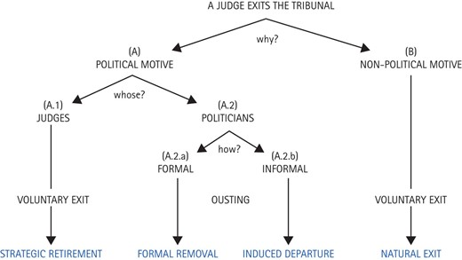

```{r globals, warning=FALSE, message=FALSE, error=FALSE}
source("utils/globals.R")
```

## Controlling the judiciary

-   how do politicians keep tabs on judges?

-   how do they ensure that delegation of judicial power does not go beyond what they originally envisaged?

-   how do judges govern themselves?

## *Ex ante* and *ex post* control

-   we can generally divide tools of political control in two categories [@helfer2005why]

    -   *ex ante*: mechanisms of control designed prior to the court's operation

    -   *ex post*: mechanisms of control developed in response to the court's operation

## Jurisdiction {.smaller}

-   a key decision liable to influence how much and over what types of issues a court has power concerns **jurisdiction** (or access / standing / *locus standi*)

-   jurisdiction is about regulating access to courts

    -   in general, the more actors can access a court, the greater its power

-   there are multiple ways of defining (= constraining) a court's jurisdiction and usually more than one is used at once

    -   geographical (e.g. US Courts of Appeals)

    -   substantive (e.g. UK Supreme Court re Scottish criminal law; higher courts ruling on "points of law only")

    -   personal (e.g. CJEU rules on standing)

## Jurisdiction (personal)

-   the CJEU has famously restrictive access rules for private litigants (Art. 263(4) TFEU)

> Any natural or legal person may \[...\] institute proceedings against an act **addressed to that person** or which is of **direct** and **individual** **concern** to them, and against a regulatory act which is of direct concern to them and does not entail implementing measures.

# Who becomes a judge?

## Who becomes a judge?

-   if judges were randomly sampled from a country's population, their preferences would be on average (in expectation) similar to the population's

    -   there would also be a lot of heterogeneity (as much as in the population)

-   in reality, judicial preferences are **systematically** influenced by a set of institutional factors

## Selection effects

-   what needed to happen for someone to become a judge on court X?

    -   what kind of person wants to become a legal professional? (*internal*)

    -   what kind of person is likely to be appointed a judge? (*external*)

-   answers to these questions will be shaped by institutional features

## Gender variation on the bench

-   US appellate judges' gender influences their votes in sex discrimination cases [@boyd2010untangling]

-   the proportion of female judges varies greatly between countries

    -   between a third and a half in common law countries

    -   over 70% in some post-socialist countries [@havelkova2022family]

-   reforming the selection process speeds up the appointment of the first woman to a peak court [@arrington2021constitutional]

## Women in the Czech judiciary {.smaller}

-   @havelkova2022family illustrate the impact of institutional factors on gender representation in the Czech judiciary

-   low pay and prestige under socialism drew many women to the bench

    -   many male judges left for private practice after 1989 and low trainee pay still deters men

    -   judging is easier to combine with family life than other legal jobs, which attracts women

-   despite higher overall numbers (61% of judges), the most important positions are occupied by men

    -   the childcare penalty hampers career progression but female judges largely accept their situation as given [@urbanikova2024art]

## Who ends up on the bench? {.smaller}

-   class and education also shape who becomes a judge

-   62% of senior UK judges went to private school, compared with 7% of the population [@suttontrust2025elitist]

    -   75% of them went to Oxford or Cambridge

    -   these shares have barely changed since 2019, partly because the bench turns over slowly

-   both selection effects are at work, from who can afford bar training to who is asked to apply

# Appointments

## Appointment procedures

-   the most salient *ex ante* mechanism

-   the designers of international courts trade off judicial independence, accountability and transparency [@dunoff2017judicial]

-   there is considerable variety in how judges are appointed around the world

## Variation in appointment procedures

```{r appointvar}
#| fig-cap: "Constitutional and supreme courts, based on @tiede2024selecting"

# data from Oxf handbook
comp <- tribble(
  ~dominant, ~n,
  "executive", 46,
  "legislature", 17,
  "courts", 1,
  "mixed", 72,
  "council", 76
)

# plot
comp |>
  ggplot(aes(x = n, y = reorder(dominant, n))) +
  geom_col() +
  theme_minimal() +
  labs(x = "Number of courts", y = "Dominant influence in selection")
```

## How can judges be chosen? {.smaller}

| who chooses | examples | predicted effects |
|--------------------------------|--------------------------------|------------------------------------|
| executive alone | Canada, Japan | loyal judges; fast, politicized |
| executive with legislative confirmation | US federal courts | confirmation fights; vacancies under divided government |
| legislative supermajority | German Constitutional Court | consensus candidates; party quotas |
| judicial council | Italy, Spain, much of Latin America | insulation; risk of corporatism or capture |
| mixed, each branch appoints a share | Spanish and Italian constitutional courts | each appointer picks allies |
| election | 38 US states incl. retention votes, Bolivia, Mexico | accountability; campaign money |

## Appointment procedures {.smaller}

-   mixed systems encourage a tendency for each appointing branch to select judges most closely aligned with its interests

    -   this cleavage may supersede partisan preferences [@tiede2020mixed; @tiede2024selecting]

-   mixed systems can hinder the functioning of collegial courts

    -   but judges with different selectors bring distinct voices, which can enhance deliberation [@tiede2020mixed]

-   more veto players =\> more moderate judges

## Judicial councils

-   institutional vehicle for judicial self-governance

-   in charge of appointing judges, promotions, discipline and sometimes budgets

-   strongly promoted by international organizations in the 2000s [@bobek2014global]

-   trade-off between insulation and external accountability [@garoupa2009guarding]

::: notes
talk about composition:

-   are judges dominant? peak or ordinary?

-   who else appoints members?
:::

## Appointing international judges {.smaller}

-   most international judges are **nominated** by governments and then **elected** by an assembly

    -   ECtHR: each state sends three names, the Parliamentary Assembly of the Council of Europe elects one

    -   ICJ: elected by the UN General Assembly and the Security Council from national-group nominations

    -   CJEU: governments appoint by common accord after consulting the Article 255 panel

## Appointing international judges {.smaller}

-   the Article 255 panel found about one in five first-time candidates unsuitable between 2010 and 2026 [@articlepanel2026work]

    -   governments followed every opinion between 2010 and 2022 [@articlepanel2022seventh]

    -   no candidate for renewal received a negative opinion

-   aspiring EU members and pro-integration governments appoint more activist ECtHR judges [@voeten2007politics]

-   the politics of selection across international courts is reviewed by @larsson2023selection

## Confirmation wars {.smaller}

-   US senators are more likely to vote for a Supreme Court nominee who is popular in their state [@kastellec2010public]

-   when the branches are divided, the appointment power becomes the power not to appoint

    -   the Senate left Merrick Garland's 2016 nomination without a hearing for over nine months, then confirmed Amy Coney Barrett within a month in 2020

-   shared appointment power can moderate judges, but sharers who wait each other out leave long vacancies

# Tenure and monitoring

## Tenure

-   the tenure of judges can differ markedly by country and type of court

    -   most ordinary judges are appointed for life, sometimes with age limits

    -   judges on constitutional and international courts are often term-bound and can sometimes be reappointed

::: notes
UK Supreme Court has mandatory retirement at 75

ICJ judges have 9-year renewable terms

ECtHR judges had their tenures increased from 6 to 9 but made non-renewable
:::

## Reappointment {.smaller}

-   the prospect of **reappointment** or re-election influences judicial behaviour

    -   judges who are up for reappointment are more responsive to the preferences of their principal

    -   US state supreme court justices facing re-election make more popular decisions than in their final term [@hall2014representation]

    -   ending renewable terms at the ECtHR reduced judges' tendency to favour their nominating state [@stiansen2022nonrenewable]

    -   secret voting at the CJEU does not shield judges from ideological deselection by governments [@hermansen2026shaping]

-   non-renewable terms can however damage a court's effectiveness

    -   turnover can affect retention of expertise

## Transparency

-   the principals' ability to monitor (and therefore punish/reward) judicial behaviour is conditional on **transparency**

-   while decisions are always public, individual votes and dissents often are not

-   do principals have other means of obtaining information about the voting of judges?

## Renewal and transparency

|                            |                      |                       |
|----------------------------|----------------------|-----------------------|
|                            | **Low transparency** | **High transparency** |
| *Life tenure*              | Low incentive        | Low incentive         |
| *Renewable fixed term*     | Low incentive        | High incentive        |
| *Non-renewable fixed term* | Low incentive        | Low incentive         |

: Interaction of renewal opportunities and transparency for judges' incentives to appease principals [@dunoff2017judicial]

## The monitoring toolkit {.smaller}

| tool | who uses it | what it reveals or punishes |
|------|------|------|
| reappointment and promotion | governments, court presidents, councils | rewards deference [@ramseyer2001why] |
| transparency of votes and dissents | everyone | who voted how; dissents at the ECtHR, none at the CJEU |
| performance evaluation and case statistics | councils, ministries | speed and output, not direction |
| disciplinary regimes | councils, special chambers | misconduct and sometimes the content of rulings |
| budgets and staffing | legislatures, ministries | capacity; hits the whole institution |

## Judicial exits

-   in established democracies judges are rarely forced out of office through removal procedures

    -   elsewhere politicians use removal procedures and informal pressure to purge courts [@perezlinan2024judicial]

-   the motivations behind a judge quitting can be more varied however

## Judicial exits



## Strategic retirements {.smaller}

-   hypothesis: federal judges in the US prefer to retire under presidents of the same political party that first appointed them [@stolzenberg2022judges; @nixon2000judicial]

    -   @stolzenberg2022judges argue that this behaviour is driven more by reciprocity norms (giving back to appointing party) than ideology

    -   in contrast, @deschler2024role find that moderate Republican appointees appear to wait out conservative presidents such as Trump (ideology matters, not just party)

-   US district judges weigh their ideological fit with the president only once eligible for a pension [@hansford2010politics]

-   understudied outside the US, and the theory finds limited support across the Americas [@perezlinan2017strategic]

# Elections

## Judicial elections {.smaller}

-   perceived rejection of "elite-driven" judicial selection

-   tried out in revolutionary France (1790) and Central America post Spanish independence [@driscoll2015judicial]

-   38 US states hold elections, including retention elections, for their supreme courts [@brusgard2025only]

    -   elected and appointed state judges behave differently in sentencing and discrimination cases [@lim2013preferences; @lim2015judge; @besley2013implementation]

    -   the 2025 Wisconsin Supreme Court election saw over 100 million USD in campaign spending [@bauer2025billionaires]

    -   Kansas voters rejected direct elections for supreme court justices in August 2026 [@kansassecretaryofstate20262026]

::: notes
the 2025 Wisconsin figure was roughly double the previous record of 51 million USD, set in Wisconsin in 2023. Wisconsin has a population of less than 6 million (cf UK almost 70)
:::

## Electing judges outside the US: Bolivia {.smaller}

-   @driscoll2015judicial evaluate Bolivia introducing judicial elections in 2011

    -   judges became much more diverse as a result (in contrast to the US)

    -   confidence in the judiciary increased among government supporters but declined overall

-   in both 2011 and 2017 more than half of the ballots cast were blank or spoilt

-   the 2024 election came a year late after disputes over candidate screening and was only partial [@internationalidea2024bolivia]

## Electing judges outside the US: Mexico {.smaller}

-   1 June 2025: the first of two rounds electing the whole federal judiciary under the 2024 reform

    -   all nine Supreme Court seats, part of the electoral tribunal, a new disciplinary tribunal and hundreds of federal judgeships

    -   candidates pre-screened by evaluation committees of the three branches; no party labels on the ballot

-   turnout was only around 13 percent of eligible voters [@aljazeera2025turnout]

## Electing judges outside the US: Mexico {.smaller}

-   the winners overwhelmingly aligned with the governing party Morena

-   a 2026 reform moved the election of the remaining posts from 2027 to 2028 [@presidenciadelarepublica2026decreto]

-   the stated aims were to democratize an elitist judiciary and end corruption

    -   the result is a judiciary chosen under one party's dominance

## Reforms as natural experiments {.smaller}

-   when appointment or tenure rules change, the change is a **shock** we can learn from

-   **difference-in-differences**: compare courts exposed to the reform with those not exposed, before and after

    -   the untouched group supplies the counterfactual trend

-   Bolivia's 2011 reform left no untouched comparison group, so @driscoll2015judicial compare surveys before and after

-   this requires that nothing else changed at the same time for the treated group only

## Can judges be made accountable without being made dependent?

## References
