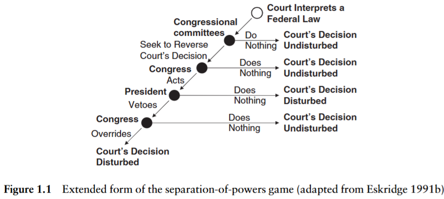
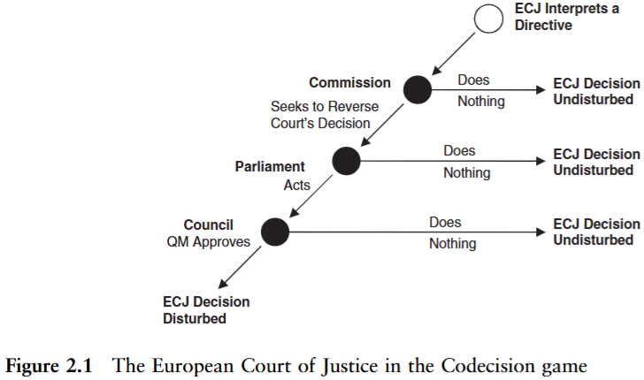
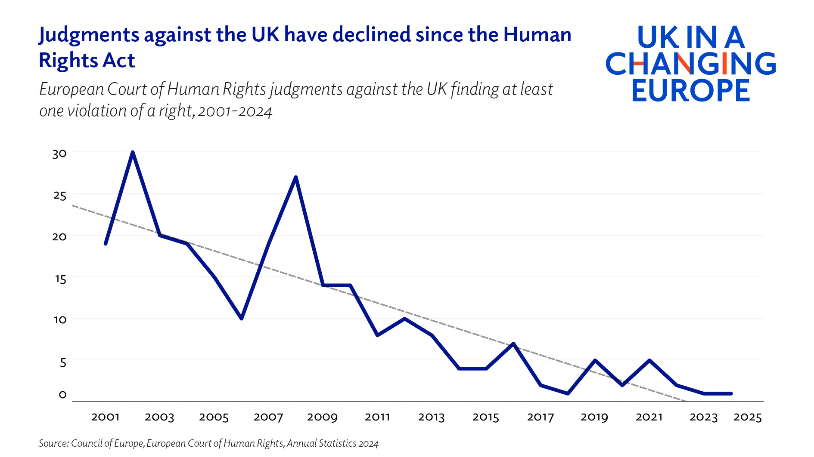

```{r globals, warning=FALSE, message=FALSE, error=FALSE}
source("utils/globals.R")
```

## Strategic interactions

-   How do courts, executives and legislatures interact in the enactment and enforcement of policy?

-   How does strategic anticipation of mutual preferences affect how they behave?

-   What happens when elected politicians decide to push back against courts?

-   And can courts be captured without formal control?

# Anticipation

## Judicial review

-   constitutional (and sometimes ordinary) courts have in many jurisdictions the power of judicial review

-   the legislating body knows its acts can be reviewed

-   courts depend on the executive branch for enforcement

    -   public support for courts makes enforcement more likely

## Anticipating judicial review

-   in general, legislators want to avoid having their laws struck down by judges

-   what is the chance the act will be **reviewed**?

    -   shaped by rules on jurisdiction and judicial review

-   what is the chance the act will be **overturned**?

    -   shaped by distance between legislator and court

## Anticipating judicial review

-   the legislature only needs to fear the courts when judicial review is likely to happen

-   in some countries this is virtually guaranteed (e.g. US), while elsewhere there will be more uncertainty

    -   in the EU, review is less likely when all institutions agree, though national courts can still refer

## Anticipating judicial review

-   the legislature only needs to fear the courts when they prefer to overturn an act

-   the legislature will look for information on:

    -   the court's previous case law

    -   judges' ideological positions

    -   public support

## Anticipating judicial review

-   in reality, no actor has complete and perfect information about the judicial review game

    -   there is **uncertainty** about how the courts will react

    -   actors sometimes behave irrationally

-   the legislator might water down an act or otherwise preempt negative judicial action

## Anticipating judicial review

-   in some cases, the legislator will not shy away from judicial conflict [@schroeder2022pushing]

    -   when they expect the public not to notice if they evade a ruling [@krehbiel2016politics]

    -   when they signal intention to not comply [@schroeder2022pushing]

## Anticipating reactions

-   courts have also reasons to fear confrontation

    -   **non-compliance** undermines their power and legitimacy

    -   may trigger **court curbing** by the other branches

    -   just like legislatures do not want to be censured by courts, courts do not want to be **overridden** by legislatures

-   judges who adjust their rulings to the expected reactions of other actors are acting **strategically** [@epstein1998choices]

## Threat of override

-   courts may anticipate overrides because legislatures do sometimes reverse their decisions [@meernik1997judicial; @larsson2021political]

    -   though US studies find little evidence that justices anticipate overrides [@segal1997separationofpowers; @segal2011congress]

-   courts are looking for judgments which are as close as possible to their ideal point but not so far as to get overridden

## Threat of override



## Threat of override



## The override incongruity {.smaller}

-   the literature stresses the **threat** of override, and CJEU rulings closely track member-state observations [@larsson2016judicial]

-   yet no override has revised the Court's mandate, though seven of 27 strongly opposed rulings were politically overridden [@larsson2021political]

    -   treaty change needs unanimous governments, a setting prone to the **joint-decision trap** [@larsson2021political; @scharpf1988jointdecision]

    -   in today's EU social policy, codification and override of rulings have both become unlikely [@martinsen2015judicial]

## The override incongruity {.smaller}

-   in the US, by contrast, Congress overrode Supreme Court statutory decisions routinely in the 1970s and 1980s [@eskridge1991overriding; @uribe2014influence]

    -   overrides peaked in the 1990s and have fallen off sharply since 1998 [@christiansen2014congressional]

-   so the system where override is least feasible is the one where the court looks most responsive to it

-   **observational equivalence**: zero observed overrides is consistent with perfect anticipation and with no constraint at all; only variation in signals, or the rare off-path case, can tell them apart

## The friendly court {.smaller}

-   consistent with the majoritarian court, the US Supreme Court strikes fewer laws when distant from Congress [@segal2011congress]

    -   a "friendly" judicial intervention can be particularly valuable when it concerns constitutional interpretation that would be otherwise difficult to legislate away (e.g. *Roe* and *Dobbs*)

    -   parties can also use courts to entrench their agenda against future majorities [@gillman2002how]

    -   also helps explain why governments might sometimes appear to support "activist" judiciaries [@whittington2005interpose]

# Curbing

## Court curbing

-   the legislator signalling intent to engage in court curbing is likely to lead to judicial self-restraint [@clark2009separation]

-   a number of possible measures:

    -   budget and staffing cuts

    -   induced judicial exits (e.g. lowering retirement age)

    -   court expansion and packing

    -   limiting jurisdiction and powers

## The court-curbing toolkit {.smaller}

| target | tools |
|------|------|
| composition | packing, retirement-age cuts, captured appointment bodies, transfers |
| jurisdiction | stripping subject matter, restricting standing, special tribunals |
| operation | budget cuts, disciplinary regimes, court presidents' powers, caseload manipulation |
| decisions | override, constitutional amendment, non-compliance, unpublished rulings |
| legitimacy | "enemies of the people" rhetoric, smear campaigns, judicial elections |

-   the tools are old; in the 2010s they were used together and openly

## Attacks on courts {.smaller}

| case | tools | outcome |
|--------------------|----------------------------------------------------|----------------------------|
| Hungary 2010-13 | jurisdiction stripped, court enlarged, retirement age cut | captured, partly reversed in 2026 |
| Poland 2015-23 | elected judges not sworn in, council captured, disciplinary chamber | tribunal captured, CJEU fines, frozen funds |
| Turkey 2010, 2016 on | court and council reshaped; 4,000+ judges and prosecutors dismissed | captured |
| Venezuela 2004 | Supreme Tribunal enlarged from 20 to 32 | captured |
| El Salvador 2021 | constitutional chamber removed on the new assembly's first day | captured |

::: notes
Castillo-Ortiz (2019) shows how illiberal governments in Hungary, Poland and Turkey gained leverage over constitutional judges and limited the courts' powers. In Poland, where the government lacked a constitutional majority, this took more complex and legally dubious strategies, such as amending the Constitutional Tribunal Act. Bugarič and Ginsburg (2016) describe how several postcommunist governments moved to pack their courts.

Hungary: after Tisza won a two-thirds majority in April 2026, the 17th Amendment (July 2026) restored the pre-2012 Constitutional Court rules, lifted limits on review of public finance laws and reinstated the age limit of 70, ending four judges' mandates.

Poland: President Nawrocki vetoed the judicial council reform in February 2026. The Sejm elected eight Tribunal judges in 2026, but Nawrocki swore in only three, and the Tribunal's president has refused entry to four who took their oath without him.
:::

## Attacks on courts {.smaller}

| case | tools | outcome |
|--------------------|----------------------------------------------------|----------------------------|
| Israel 2023-25 | reasonableness standard abolished, selection committee reshaped | first struck down in 2024, second not yet in force |
| United States 1937, 2025-26 | court-packing plan; injunction limits, impeachment calls | 1937 plan failed, 2025 bill passed House |
| United Kingdom 2016-24 | "enemies of the people"; limits on review remedies; Rwanda Act ouster | rhetoric loud, curbing modest |

::: notes
Israel: the Supreme Court struck down the reasonableness amendment 8-7 on 1 January 2024. The March 2025 law giving politicians more seats on the Judicial Selection Committee takes effect with the next Knesset. In December 2025 the court unanimously annulled the dismissal of the Attorney General.

United States: the House passed the No Rogue Rulings Act 219-213 in April 2025, and Republicans filed impeachment articles against Judge Boasberg. In Trump v. CASA (June 2025) the Supreme Court itself curbed universal injunctions by lower courts.

United Kingdom: the Safety of Rwanda Act 2024 told courts to treat Rwanda as safe and barred challenges on that ground. It was repealed in December 2025.
:::

## Why attack, why refrain, how courts respond {.smaller}

-   **why attack**

    -   to signal a risk to the court's legitimacy and induce restraint [@clark2009separation]

    -   to remove a check on power: abusive constitutionalism [@landau2013abusive], autocratic legalism [@scheppele2018autocratic; @castilloortiz2019illiberal; @bugaric2016assault]

    -   to punish judges loyal to the previous government, so judges defect as it weakens [@helmke2002logic]

    -   attacks often come from populist leaders and use populist rhetoric [@voeten2020populism]

## Why attack, why refrain, how courts respond {.smaller}

-   **why refrain**

    -   electoral costs, if voters punish attacks [@driscoll2023costs]

    -   international audiences: the EU, the ECtHR, investors

    -   insurance, since parties that may lose power value courts as a forum to challenge the winners [@ginsburg2003judicial]

-   **how courts respond**: defect [@helmke2002logic], restrain themselves [@stiansen2020backlash], resist openly or exit

# Backlash and backsliding

## Backlash


## Backlash against courts

-   what drives **backlash** against international courts?

    -   probably the same thing that drives backlash against domestic courts: disagreement with outcomes

    -   populist leaders started most backlashes against international courts but not all of them [@voeten2020populism]

-   *political* backlash against courts is distinct from backlash in public opinion

## Backlash against courts

-   evidence of greater **self-restraint** in response to backlash

    -   dissenting ECtHR judges increasingly say the Grand Chamber is quietly walking back rights [@helfer2020walking]

    -   it also finds fewer violations by democracies that criticized it [@stiansen2020backlash]

## Declining UK ECHR violations



::: notes
The ECtHR found at least one violation in 4 of its 10 UK judgments in 2025, up from 1 in 2024.
:::

## Judicialization and politicization {.smaller}

-   courts expand their power through decisions on **public** policy and state institutions

    -   such matters naturally invite *politicization* which can lead to decline of trust in the long run

-   as courts grow in importance, they also become more interesting to the public and attractive to **politicians**

    -   *judicialization* –\> *politicization*

-   politicians do not act merely within the rules but also **with respect** to the rules (existing institutions)

    -   if e.g. packing a court with loyalists helps to win power or realize political preferences, they will often do it

## Politicization

-   beyond court curbing measures enacted by politicians, law and courts can become **politicized** also by

    -   judicial elections

    -   high-profile decisions

    -   political polarization

    -   autocratization

## Dejudicialization {.smaller}

-   is the era of increasing judicialization over? [@abebe2019dejudicialization]

    -   most obvious in the backlash against international courts, e.g. the WTO Appellate Body, paralysed since 2019

-   but there are also signs in domestic politics

    -   e.g. the near total delegitimization of the Polish Constitutional Court in recent years, conservative backlash in Israel, Turkey and elsewhere
    -   open question whether backlash and counter movements will sustain judicialization or reverse it through institutional attacks

## The EU's rule-of-law toolbox {.smaller}

-   **Article 7 TEU** was triggered against Poland (2017) and Hungary (2018) but never reached sanctions

    -   finding a breach needs unanimity minus the target, and the Polish procedure was closed in 2024

    -   the Hungarian procedure remains open after the 2026 change of government

-   **infringement actions**: the Commission takes the member state to the CJEU – Hungary's retirement-age cut (2012), Poland's Supreme Court law (2019) and disciplinary regime (2021)

## The EU's rule-of-law toolbox {.smaller}

-   **preliminary references**: national judges ask the CJEU whether their own country's judicial reforms are compatible with EU law, turning Luxembourg into an ally of domestic courts

-   **conditionality** has let the EU withhold funds for rule-of-law breaches since 2021

    -   Hungary lost access to billions until the measures were lifted in October 2026

    -   Poland's recovery funds were frozen under separate conditions until 2024

-   in *Xero Flor* (2021) the ECtHR found a Tribunal bench with an irregularly elected judge was not "established by law"

-   the tools bite slowly, mostly after the capture is complete

# Capture

## What is capture?

-   **capture**: an institution meant to constrain an actor comes to serve it [@stigler1971theory; @dalbo2006regulatory]

    -   the term comes from regulators and the industries they regulate

-   **judicial capture**: courts end up serving those they should check

    -   formally, through composition, appointments and jurisdiction

    -   informally, through favours, careers and perks

## Capture without formal control {.smaller}

-   many interactions between courts and representatives of other branches can occur outside formal contexts

-   as members of the elite with access to power and resources, both judges and politicians can face incentives to confer special treatment

    -   e.g. judges may shield corrupt politicians from conviction in exchange for bribes or career progress

    -   governments can reward judges with housing, as in Pakistan [@mehmood2024judicial]

## Capture without formal control {.smaller}

-   ruling-party Indian state legislators who narrowly win see more cases closed without conviction [@pobletecazenave2025do]

-   narrowly elected Brazilian mayors are about two thirds less likely to be convicted [@lambais2023judicial]

    -   mayors play no direct role in judges' careers

-   de jure separation is not sufficient to capture intended benefits of judicial independence – and these are democracies

## Regression discontinuity {.smaller}

-   when a treatment switches on at a threshold, units just either side of it are comparable

    -   the jump in outcomes at the threshold estimates the effect for units near it

-   close elections are the classic case because narrow winners and losers should differ only in taking office

-   used for the Indian and Brazilian results [@pobletecazenave2025do; @lambais2023judicial]

-   what to check: enough close races? anything else changing at the threshold? manipulation of who wins?

## Why do governments that could ignore courts bother to capture them?

## References
