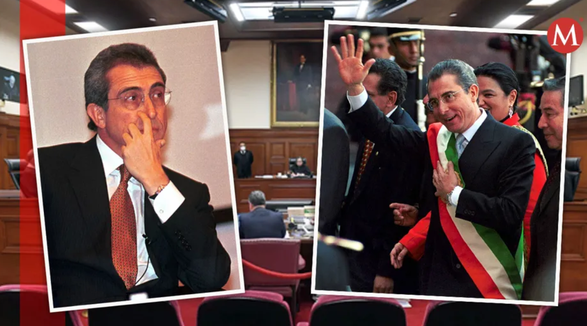
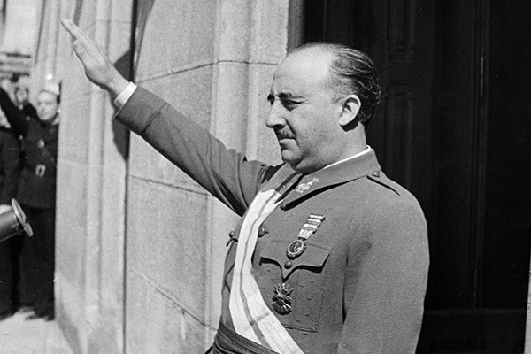

```{r globals, warning=FALSE, message=FALSE, error=FALSE}
source("utils/globals.R")
```

## Assessment

-   before you start writing, make sure to:

    -   read the Assessment page on the website extremely carefully

    -   read the FAQ page on the website

    -   consult the lecture slides on the research paper

## Assessment: write clearly {.smaller}

**What was the hypothesis in this paper?**

> South Africa is a noteworthy example of a country who created a constitutional court in order to successfully transition into democratization. This decision came at the cost of changing the jurisdictional scope and hierarchical standing of the Appellate division, now known as the Supreme Court of Appeal (SCA). This shift in the SCA’s jurisdictional scope and hierarchical standing allowed the Constitutional Court of South Africa (CC) to form a constitutional precedent, which I hypothesize increased the CC’s effectiveness and consequently contributed to South Africa’s successful transition into a democratic regime.

## Courts without democracy

-   most theories of courts assume a liberal democracy: elected politicians, an independent judiciary, a public that can punish

-   most of the world's courts operate without at least one of those [@coppedge2026vdem]

-   this week: why autocrats build courts, what those courts do and when they turn on their makers

-   and what this says about a literature written mostly about the US and Europe

# Why autocrats build courts

## What are courts for in an autocracy? {.smaller}

| function | what the ruler gets | examples |
|------------------------|----------------------------------|------------------------------------------|
| social control | dissent handled as law, not repression | Singapore's defamation suits |
| legitimation | power dressed as legality | Marcos's Philippines, Sadat's Egypt [@ginsburg2008rule] |
| administrative discipline | courts watch local officials | China's administrative litigation [@cao2023suing] |
| credible commitment | investors trust property rights | Egypt [@moustafa2003law] |
| blame-shifting | judges take the blame | Egypt's privatization and rent control [@moustafa2003law] |
| repressing rivals | trials discipline insiders | @shenbayh2018strategies |

-   each function needs a somewhat believable court [@ginsburg2008rule; @moustafa2014law]

## Insurance theory of court power

-   empowering courts comes at a cost to executives and legislators

-   empowering courts can **insure** incumbents who expect to lose power against their successors [@ginsburg2003judicial; @finkel2005judicial]

    -   powerful courts can make it harder to change policy direction

    -   they can also protect the former ruling party once it is in opposition

## 1994 judicial reform in Mexico {.smaller}

-   after winning elections in 1994 president Ernesto Zedillo decided to make the Mexican judiciary more independent and powerful – why?

-   @finkel2005judicial explains this counterintuitive move as a form of insurance policy

    -   the ruling Institutional Revolutionary Party was losing support and feared losing national power

    -   the reform gave the Mexican Supreme Court more power to circumscribe (federal and state) government policy

-   the 2024 reform replaced the court with nine justices elected by popular vote in 2025

    -   V-Dem's score for Mexico's high court independence fell by more than half in 2025 [@coppedge2026vdem]

## 1994 judicial reform in Mexico

{width="600"}

## Independence by regime type

```{r vdemregime, warning=FALSE, message=FALSE}
#| fig-cap: "Source: @coppedge2026vdem"
vdemdata::vdem |>
  filter(year == max(year)) |>
  select(country_name, v2x_regime, v2juhcind_osp) |>
  drop_na() |>
  mutate(regime = factor(v2x_regime, levels = 0:3,
                         labels = c("closed autocracy", "electoral autocracy",
                                    "electoral democracy", "liberal democracy"))) |>
  ggplot(aes(x = regime, y = v2juhcind_osp)) +
  geom_boxplot(outlier.shape = NA) +
  geom_jitter(width = 0.15, alpha = 0.3) +
  geom_text(data = function(d) filter(d, country_name %in% c("Singapore", "United Arab Emirates", "Hungary", "Poland", "Venezuela", "United States of America")),
            aes(label = country_name), hjust = -0.1, size = 3) +
  theme_minimal() +
  labs(x = NULL, y = "High court independence (0-4)",
       title = "Judicial independence by regime type",
       subtitle = "V-Dem, latest year; Regimes of the World classification")
```

## Judicial power over time

```{r vdemautocracies}
#| fig-cap: "Source: @coppedge2026vdem"
vdemdata::plot_indicator("v2x_jucon",
                         min_year = 1970,
                         countries = c("Egypt", "China", "Russia", "Venezuela", "Hungary")) +
  theme_minimal() +
  theme(legend.position = "bottom") +
  scale_x_continuous() +
  labs(y = "Judicial constraints (0-1)",
       title = "Judicial constraints on the executive",
       subtitle = "V-Dem index 'judicial constraints on the executive'") +
  guides(linetype = "none")
```

# The dual state

## The dual state {.smaller}

-   Fraenkel, writing from inside Nazi Germany, described two states in one [@fraenkel2017dual]

    -   the **normative state**: ordinary law applied by ordinary courts to contracts, crimes and property

    -   the **prerogative state**: power acting without legal limits whenever it decides a matter is political

-   the regime draws the boundary case by case and can override ordinary law at will [@fraenkel2017dual]

-   scholars have applied the concept to Francoist Spain, Russia, China and Singapore [@hendley2022legal]

    -   in China environmental litigation lets lawyers probe the boundary of what is politically possible [@stern2013environmental]

-   for the study of courts it means that country-level independence scores average over two very different things

## Judicial independence in Francoist Spain

-   @toharia1975judicial finds that judges in Franco's Spain held remarkably diverse political views

-   ordinary judges were by and large insulated from the threat of removal or punishment by the government

-   however, the regime interfered with independence in politically sensitive cases by creating and staffing a host of special tribunals

## Judicial independence in Francoist Spain



## Legal dualism

-   @hendley2022legal argues that the creation of special tribunals for political issues is the exception in authoritarian regimes

    -   instead, the "normative" and "prerogative" states coexist side by side, often relying on informal institutions

    -   e.g. the same judge handling ordinary cases can be twisting the law to enable the persecution of dissidents

## China {.smaller}

-   **tying the autocrat's hands**: courts treat commercial cases more fairly where the party needs foreign investors [@wang2015tying]

-   **suing the government**: administrative litigation lets citizens challenge local officials; transferring such cases outside the local county raised the chance of the local government losing by about 4 percentage points [@cao2023suing]

-   **anti-corruption and court bias**: politically connected listed firms won more often in commercial disputes until the anti-corruption campaign after 2012 weakened the advantage [@zhang2023anticorruption]

-   courts work for the centre against local officials and connected firms, and stop where the centre's own power begins

## Rule by law in Singapore {.smaller}

-   Singapore has no special tribunals, and its courts rank highly for efficiency and reliability [@silverstein2008singapore]

-   the same courts have bankrupted opposition politicians through defamation suits brought by ministers

-   the regime uses legislation to police the press, lawyers, religion and public order [@rajah2012authoritarian]

-   **authoritarian rule of law** uses legislation and legal procedure to make illiberal rule look legitimate [@rajah2012authoritarian]

-   Singapore's courts score well on formal independence but do not constrain the government politically [@ginsburg2008rule]

# When courts bite

## When do courts in autocracies bite? {.smaller}

| condition | mechanism | evidence |
|-------------------|------------------------------------|--------------------------------------------|
| audiences | a bar, press or public backs the judges | Pakistan's lawyers [@ghias2010miscarriage; @kureshi2021when] |
| low competition | rulers interfere when the opposition might win | Russia and Ukraine [@popova2010political], election fraud [@harvey2022can] |
| fragmentation | divided rulers cannot punish judges | [@helmke2009regimes] |
| elections | independence reforms and support networks back judges | Kenya 2017 [@gerzso2023judicial] |
| international audiences | investors, donors, accession talks | Egypt's investors [@moustafa2003law] |
| dual state | independence survives in the normative state only | Spain, Russia, China |

## Lawyers against the regime {.smaller}

-   in 2007 lawyers protested for two years after Musharraf suspended Pakistan's chief justice [@ghias2010miscarriage]

    -   the chief justice was restored in 2009 after a lawyers' long march

    -   in 2025 the 27th Amendment moved constitutional cases to a new Federal Constitutional Court [@malik2025shifting]

-   the **legal complex** of lawyers and judges drives advances or retreats from political liberalism [@halliday2007fighting]

## Lawyers against the regime {.smaller}

-   the same complex can be captured when regimes prosecute or disbar lawyers

    -   Turkey has prosecuted more than a thousand lawyers since the 2016 coup attempt [@humanrightswatch2019lawyers]

    -   Belarus has disbarred lawyers for apparently political reasons since 2020 [@helsinkifoundationforhumanrights2021public]

-   audiences matter because a judge who rules against the regime needs someone to notice

## Elections and annulments {.smaller}

-   courts in competitive authoritarian and hybrid regimes are most exposed when they rule on elections, and that is also when they are most watched

-   in 2017 Kenya's Supreme Court annulled the presidential election, a first in Africa [@gerzso2023judicial]

    -   the opposition boycotted the rerun and the president attacked the judges

-   in 2020 Malawi's Constitutional Court annulled the 2019 presidential election over widespread irregularities

    -   the Supreme Court of Appeal upheld the ruling and the opposition won the rerun

-   in both cases the outcome depended on whether the government complied and how the opposition and voters responded

## Courts in the Global South {.smaller}

-   most research on courts takes North American and Western European democracies as its baseline [@riosfigueroa2025courts]

-   most of the world's courts sit in weaker states alongside customary and religious forums [@riosfigueroa2025courts]

-   independence and compliance mean something different when the ruling party is the state and the state barely reaches the village

-   research designs travel badly too, since court archives are patchy and records can vanish [@riosfigueroa2025courts]

-   research on the Global South finds courts often effective by standards different from the North [@riosfigueroa2025courts]

-   which findings about courts would you expect to hold in Lagos, Lahore or Lima?

## Can a court be independent in an undemocratic state?

## References
